 <div align="center">



# NaoByte ♡

*Where love meets code.*


</div>

---

## ♡ About the project

NaoByte is a personal web project created as a special birthday gift for my favorite person.

A little universe where creativity, programming and love come together.

Every line of code, every illustration and every interaction was designed with love.

## ✦ Features

- Personalized landing page.
- Custom illustrations and decorative elements.
- Interactive love letter with an animated envelope.
- Rotating 3D carousel.
- Hidden hamburger rain effect.
- Smooth scrolling and entrance animations.
- Responsive design for mobile, tablet and desktop.
- Time-based carousel animation.
- Dynamic adaptation to viewport resizing.

## ✦ Project structure

```text
NaoByte/
├── fonts/
├── img/
├── index.html
├── style.css
├── script_2.js
└── README.md
```

## ✦ Live website

[Explore NaoByte ♡](https://naobyte.netlify.app)

## ♡ The inspiration

> You are the code my heart understands perfectly,
> the bug I would never fix, and the constant
> I want in every version of my life.

---

<div align="center">

**Made with love by Ari ♡**

*Designed with love. Built with code.*

NaoByte Project — 2026

</div>

The inspiration:
You are the code my heart understands perfectly, the bug I would never fix, and the constant I want in every version of my life.

Made with love by Ari ♡
NaoByte Project — 2026
